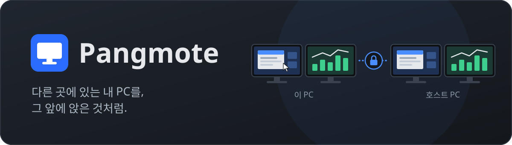
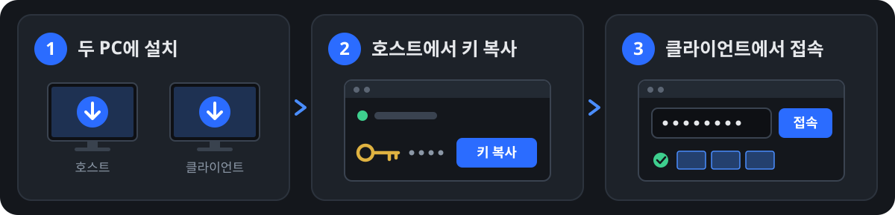
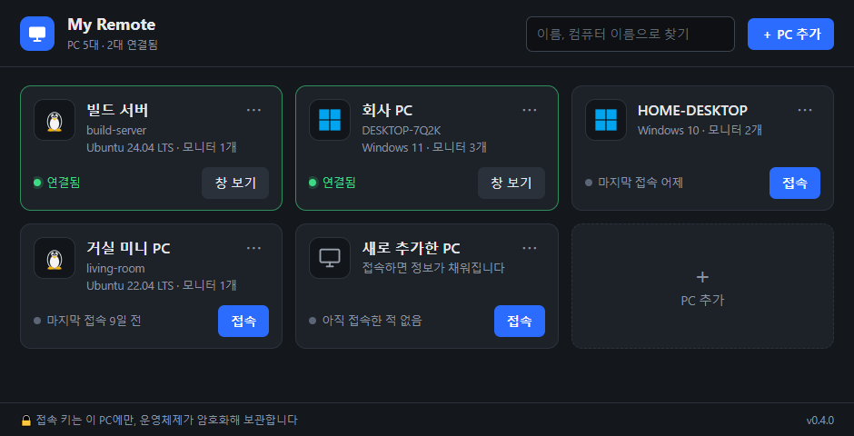
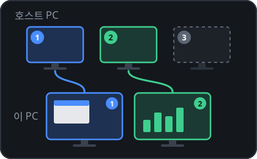
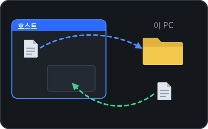
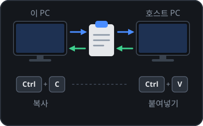
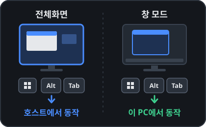
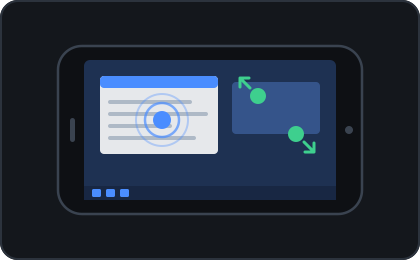
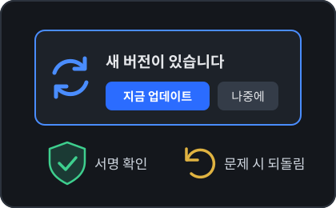
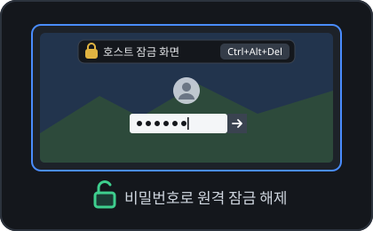

<h1 align="center">
  
</h1>

<p align="center">
  <b>다른 곳에 있는 내 PC를, 그 앞에 앉은 것처럼 쓰는 원격 데스크톱</b><br>
  <sub>🔗 P2P 직접 연결 &nbsp;·&nbsp; 🔒 종단간 암호화 &nbsp;·&nbsp; 🖥️ 다중 모니터 &nbsp;·&nbsp; 🗂️ 여러 PC 동시 접속 &nbsp;·&nbsp; 📂 파일 끌어다 놓기 &nbsp;·&nbsp; 📋 클립보드 공유 &nbsp;·&nbsp; 🚪 포트 개방 불필요</sub>
</p>

<p align="center">
  <a href="https://github.com/GiUKim/my-remote/releases/latest/download/MyRemote-Windows-x64.zip"></a>
  &nbsp;&nbsp;
  <a href="https://github.com/GiUKim/my-remote/releases/latest/download/MyRemote-Linux-x64.tar.gz"></a>
</p>

<p align="center">
  <sub>⊞ Windows 10 · 11 (64비트) &nbsp;|&nbsp; 🐧 Linux X11 세션 (Ubuntu 22.04 · 24.04) &nbsp;|&nbsp; 🍎 macOS용은 아직 없습니다 &nbsp;|&nbsp; <a href="https://github.com/GiUKim/my-remote/releases">모든 버전</a></sub>
</p>

### 🐧 Ubuntu는 터미널로도 설치할 수 있습니다

위 **Linux용 내려받기**와 같은 파일(데스크톱 앱)을 받아 `~/MyRemote`에 풉니다. 블록 오른쪽 위의 복사 단추로 복사해 터미널에 붙여 넣으세요.

```bash
cd ~ && wget -qO- https://github.com/GiUKim/my-remote/releases/latest/download/MyRemote-Linux-x64.tar.gz | tar -xz
```

Ubuntu 24.04(23.10 이후)만, 한 번: 브라우저 엔진의 샌드박스 도우미를 켭니다(관리자 비밀번호를 묻습니다).

```bash
sudo chown root:root ~/MyRemote/chrome-sandbox && sudo chmod 4755 ~/MyRemote/chrome-sandbox
```

앱 메뉴에 `My Remote`를 만들고 시작합니다.

```bash
~/MyRemote/my-remote.sh --shortcuts
~/MyRemote/my-remote.sh             # 시작 화면 (호스트로 바로 시작하려면 --host, 클라이언트는 --client)
```

<sub>X11 데스크톱 세션이 필요합니다(Wayland면 로그인 화면 오른쪽 아래 톱니바퀴에서 "Ubuntu on Xorg"). SSH 터미널에서 실행하면 그 PC에 로그인되어 있는 데스크톱에 뜨고, 접속 키는 `~/MyRemote/my-remote.sh --show-key`로 터미널에서 봅니다. 화면 앞에 없는 PC(SSH로만 관리하는 PC)는 [Linux](#linux)를 보세요.</sub>

## 🚀 3단계로 시작

<p align="center">
  
</p>

| | 할 일 | 방법 |
|:-:|---|---|
| 1️⃣ | **두 PC에 설치** | 내려받아 압축을 풀고 실행합니다. Windows `MyRemote.exe` · Linux `./my-remote.sh` |
| 2️⃣ | **호스트에서 키 복사** | 조종받을 PC에서 시작 화면의 `이 PC 공유` → 창의 `키 복사` → 비밀번호 관리자에 보관 |
| 3️⃣ | **클라이언트에서 접속** | 내가 앉은 PC에서 시작 화면의 `다른 PC에 접속` → `＋ PC 추가`에 키 붙여넣기 → `추가하고 접속` |

> 💡 **앱은 하나입니다.** 두 PC에 같은 앱을 설치하고, 실행하면 나오는 큰 버튼 두 개 중 **이 PC 공유**(호스트, 조종받을 PC)나 **다른 PC에 접속**(클라이언트, 내가 앉은 PC)을 고릅니다. 바로가기도 `MyRemote` 하나이고, 업데이트도 한 번이면 두 쪽 모두 새 버전이 됩니다.
>
> 🛡️ Windows에서 "Windows의 PC 보호" 창이 뜨면 `추가 정보` → `실행`을 누르세요.

## 🗂️ 여러 PC를 한 곳에서

<p align="center">
  
</p>

| | | |
|:-:|---|---|
| 🗂️ | **PC 목록** | 등록한 PC가 운영체제, 컴퓨터 이름, 마지막 접속 시각과 함께 보입니다. 이름은 원하는 별명으로 바꿀 수 있습니다 |
| 🪄 | **여러 대 동시에** | PC마다 창이 따로 열립니다. Windows든 Linux든 여러 호스트를 나란히 띄워 놓고 오가며 씁니다 |
| 🔒 | **키는 한 번만** | 접속 키는 추가할 때 한 번 넣으면 이 PC에 암호화해 보관합니다. 다음부터는 `접속`만 누릅니다 |

## ✨ 한눈에 보는 기능

<table>
  <tr>
    <td align="center" valign="top" width="33%">
      <br>
      <b>🖥️ 모니터마다 한 화면</b><br>
      <sub>호스트 모니터를 내 모니터에 하나씩 펼칩니다.<br>짝은 끌어다 놓아 바꿉니다.</sub>
    </td>
    <td align="center" valign="top" width="33%">
      <br>
      <b>📂 파일 끌어다 놓기</b><br>
      <sub>원격 화면에서 내 PC로, 내 PC에서 원격 화면으로.<br>폴더째로도 됩니다.</sub>
    </td>
    <td align="center" valign="top" width="33%">
      <br>
      <b>📋 하나의 클립보드</b><br>
      <sub>한쪽에서 복사해 다른 쪽에 붙여넣습니다.<br>글자도, 파일도.</sub>
    </td>
  </tr>
  <tr>
    <td align="center" valign="top">
      <br>
      <b>⌨️ 전체화면은 호스트, 창은 내 PC</b><br>
      <sub>전체화면에서는 <kbd>Alt</kbd>+<kbd>Tab</kbd>, <kbd>Win</kbd> 키도<br>호스트로 갑니다.</sub>
    </td>
    <td align="center" valign="top">
      <br>
      <b>📱 휴대폰·태블릿</b> <sub>(시험 단계)</sub><br>
      <sub>탭, 길게 누르기, 두 손가락 확대로<br>조작합니다.</sub>
    </td>
    <td align="center" valign="top">
      <br>
      <b>🔄 스스로 업데이트</b><br>
      <sub>새 버전을 알려 줍니다. 시작되지 않으면<br>이전 버전으로 돌아갑니다.</sub>
    </td>
  </tr>
  <tr>
    <td align="center" valign="top">
      <br>
      <b>🔒 잠긴 PC도 원격으로 풀기</b><br>
      <sub>호스트가 잠겨 있으면 잠금 화면이 보이고<br>비밀번호를 쳐서 풉니다.</sub>
    </td>
    <td colspan="2" valign="top">
      <sub><b>Windows 호스트</b>: 호스트를 처음 시작할 때 <b>"잠금 화면에서도 원격 조종을 켤까요?"</b>에서 <b>켜기</b>를 누르고 관리자 권한 확인 창(UAC)에서 <b>예</b>를 누르면 끝입니다(나중에 호스트 창의 같은 이름 칸에서 켜도 됩니다). 이미 잠긴 PC에 접속해도 잠금 화면이 보입니다. 비밀번호는 그대로 필요하고, UAC 창은 원격에서 보기만 됩니다. 회사 PC처럼 <kbd>Ctrl</kbd>+<kbd>Alt</kbd>+<kbd>Del</kbd>을 요구하면 화면 위의 버튼으로 보냅니다.<br><br>
      <b>Linux 호스트</b>(X11, GNOME): 설치할 것 없이 됩니다.<br><br>
      재부팅 직후의 로그인 화면은 아직 안 됩니다(호스트가 로그인한 사용자의 프로그램이라서).</sub>
    </td>
  </tr>
</table>

## ⌨️ 단축키

| | 키 | 동작 |
|:-:|---|---|
| ↔️ | <kbd>Ctrl</kbd>+<kbd>Alt</kbd>+<kbd>←</kbd> / <kbd>→</kbd> | 이전 / 다음 모니터 |
| 🔢 | <kbd>Ctrl</kbd>+<kbd>Alt</kbd>+<kbd>1</kbd>…<kbd>9</kbd> | 그 번호의 모니터 |
| 🗺️ | <kbd>Ctrl</kbd>+<kbd>Alt</kbd>+<kbd>↑</kbd> 또는 <kbd>0</kbd> | 전체 보기 (모든 모니터를 한 창에) |
| 🔍 | <kbd>Ctrl</kbd>+<kbd>Alt</kbd>+<kbd>↓</kbd> | 화면에 맞춤 ↔ 원본 크기(1:1) |
| 🖥️ | <kbd>Ctrl</kbd>+<kbd>Alt</kbd>+<kbd>Enter</kbd> | 전체화면 켜기 / 끄기 |
| 📋 | <kbd>Ctrl</kbd>+<kbd>C</kbd> → <kbd>Ctrl</kbd>+<kbd>V</kbd> | 한 PC에서 복사, 다른 PC에서 붙여넣기 (글자·파일) |

<sub><kbd>Ctrl</kbd>+<kbd>Alt</kbd> 조합은 호스트로 가지 않습니다. 호스트에서 같은 조합을 써야 하면 툴바의 <code>단축키</code>에서 끌 수 있습니다.</sub>

**어느 PC가 키를 받나요?**

| 키 | 🖥️ 전체화면 | 🔲 창 모드 |
|---|:-:|:-:|
| <kbd>Win</kbd> · <kbd>Alt</kbd>+<kbd>Tab</kbd> · <kbd>Alt</kbd>+<kbd>F4</kbd> · <kbd>PrtSc</kbd> | 호스트 | 이 PC |
| 그 밖의 키 (글자, 방향키, <kbd>Ctrl</kbd>+<kbd>C</kbd> …) | 호스트 | 호스트 |
| <kbd>Ctrl</kbd>+<kbd>Alt</kbd>+<kbd>Del</kbd> · <kbd>Win</kbd>+<kbd>L</kbd> | 이 PC | 이 PC |

## 🖱️ 마우스·터치 동작

| | 이렇게 하면 | 이렇게 됩니다 |
|:-:|---|---|
| 📤 | 원격 화면 속 파일·글자를 끌어 **창 밖**에 놓기 (창 모드) | 놓은 곳(이 PC)으로 가져옵니다 |
| ⚡ | <kbd>Ctrl</kbd>을 누른 채 끌고 나가기 | 기다리지 않고 바로 이 PC 쪽으로 넘어옵니다 |
| 📥 | 이 PC의 파일·폴더를 **원격 화면 위**에 놓기 | 호스트의 그 자리에 놓입니다 |
| ↔️ | 원격 화면 속 창을 끌어 가장자리 너머로 | 호스트의 옆 모니터로 넘어갑니다 |
| 🧩 | `모니터 배치`에서 모니터 그림 끌어다 놓기 | 자리 바꾸기 · <kbd>Ctrl</kbd>+끌기는 나란히 함께 · 클릭은 끄기/켜기 |

**📱 손가락으로** <sub>(휴대폰·태블릿, 시험 단계)</sub>

| | 손가락 | 결과 |
|:-:|---|---|
| 👆 | 탭 | 클릭 |
| ⏳ | 길게 누르기 | 우클릭 |
| ✊ | 잠깐 누르고 있다가 끌기 | 드래그 (글자 선택, 창 옮기기) |
| ↕️ | 쓸기 | 스크롤 |
| 🤏 | 두 손가락 벌리기·오므리기 | 확대·축소, 화면 이동 |
| ⌨️ | 툴바의 `⌨ 키보드` · `특수키` | 글자 입력 · Esc, Tab, Ctrl, Alt, 방향키 등 |

## 🔄 업데이트

- 🔔 **일반 업데이트** — 새 버전을 알려 주고, `지금 업데이트`를 눌러야 설치합니다.
- 🔍 **바로 확인** — 두 앱 모두 이름 옆에 지금 버전과 `업데이트 확인`이 있습니다(호스트 창 맨 위, 클라이언트 앱 PC 목록 맨 위). 누르면 바로 확인하고, 새 버전이 있으면 지금 업데이트할지 묻습니다. 누르지 않아도 시작 20초 뒤와 6시간마다 확인합니다.
- 🔗 **한 번이면 둘 다** — 호스트와 클라이언트 중 한쪽에서 업데이트하면, 켜져 있는 다른 쪽도 그 버전으로 다시 시작합니다(호스트는 원격 접속이 없을 때 저절로, 클라이언트는 원격 창이 열려 있으면 물어본 뒤).
- 🚨 **중요 업데이트** — 심각한 문제를 고친 버전은 묻지 않고 설치합니다. 호스트는 원격 접속이 없을 때 다시 시작합니다.
- ↩️ **되돌리기** — 새 버전이 시작되지 않으면 스스로 이전 버전으로 돌아갑니다.

## ⚠️ 알아 둘 점

- 🔒 **Windows 호스트를 잠긴 채로 쓰려면 "잠금 화면에서도 원격 조종"을 켜 두세요.** 호스트를 처음 시작할 때 묻습니다(관리자 승인 한 번). 켜지 않으면 잠금 화면과 권한 확인(UAC) 창은 보이지도 조작되지도 않습니다. 켜도 UAC 창은 보기만 되고, 재부팅 직후의 로그인 화면은 안 됩니다. 원격 접속 중에는 켜거나 끌 수 없습니다(Windows의 승인 창은 그 PC 앞에서만 누를 수 있습니다). 절전 모드는 꺼 두세요(절전에 들어가면 연결이 끊깁니다). Linux(X11, GNOME) 호스트는 설치할 것 없이 잠금 화면에 비밀번호를 입력해 풀 수 있습니다.
- 🏢 **PC의 화면과 입력을 통째로 넘기는 도구입니다.** 회사 PC라면 보안 정책에서 허용되는지 먼저 확인하세요.
- 🔑 **접속 키가 유일한 인증 수단입니다.** 비밀번호 관리자에 보관하고, 노출이 의심되면 호스트 창의 `새 키 발급`을 누르세요.
- 🐧 **Linux는 X11 세션에서만 됩니다**(Wayland 미지원). macOS용은 아직 없습니다.
- 🧪 개인이 만든 프로그램이며 **보안 감사를 받지 않았습니다.**

## 📚 자세히

<sub>아래는 접어 둔 설명서입니다. 제목을 누르면 펼쳐집니다.</sub>

<details>
<summary>📖 <b>소개 · 먼저 읽어 주세요</b></summary>

개인용 P2P 원격 데스크톱입니다. 회사 PC(호스트)의 화면을 집 PC(클라이언트)의 브라우저에서 보고 조작합니다.
Chrome 원격 데스크톱과 같은 기술(WebRTC)을 쓰되, **멀티 모니터를 모니터별 창으로 펼쳐 쓰는 것**에 맞췄습니다.

- 호스트: Windows 10/11, 관리자 권한 불필요, 외부 포트 개방 불필요. Linux(X11 세션)에서도 동작합니다 ([Linux](#linux) 참고)
- 클라이언트: 설치 없음. HTML 파일 하나를 Chrome 또는 Edge로 엽니다
- 인증: 호스트 PC마다 자동 생성되는 256비트 접속 키

> **먼저 읽어 주세요**
> - 이 프로그램은 PC의 화면과 입력을 통째로 넘기는 도구입니다. 회사 PC에 쓰기 전에 **회사 보안 정책에서 허용되는지 확인**하세요.
> - 개인이 만든 코드이며 **보안 감사를 받지 않았습니다.**
> - **Windows 호스트의 잠금 화면은 "잠금 화면에서도 원격 조종"을 켜야 보입니다**(호스트를 처음 시작할 때 묻습니다). 켜지 않으면 잠금 화면과 UAC 창은 보이지도 조작되지도 않습니다. ([한계](#한계) 참고)

</details>

**설치와 업데이트**

<details>
<summary>📦 <b>앱으로 설치하기 (Windows, Linux)</b> — 받는 파일, 처음 실행, 바로가기</summary>

### 앱으로 설치하기 (Windows, Linux)

소스 폴더와 설치 스크립트 없이, 내려받은 묶음을 풀어 바로 실행하는 **설치형 앱**입니다. 호스트와 클라이언트가 한 앱에 들어 있고, 새 버전은 앱이 알아서 확인합니다.

| 운영체제 | 받는 파일 | 실행 |
|---|---|---|
| Windows 10/11 (64비트) | `MyRemote-Windows-x64.zip` | 원하는 곳에 풀고 `MyRemote.exe` 실행 |
| Linux (X11 세션, Ubuntu 22.04·24.04에서 시험) | `MyRemote-Linux-x64.tar.gz` | 원하는 곳에 풀고 `./my-remote.sh` 실행 |
| macOS | 아직 없습니다 | Apple 개발자 서명이 있어야 실행할 수 있어 만들지 못했습니다 |

1. 실행하면 시작 화면의 큰 버튼 두 개 중 **이 PC 공유**(호스트: 이 PC를 원격으로 조종받기)나 **다른 PC에 접속**(클라이언트)을 고릅니다. "바로가기 만들기"를 켜 두면 시작 메뉴의 `MyRemote` 폴더에 `MyRemote` 바로가기(Linux는 앱 메뉴에 `My Remote`)가 생기고, 다음부터는 그것을 누르면 시작 화면이 뜹니다. 둘 다 쓰려면 한 번 더 실행해 다른 쪽을 고르면 됩니다. 0.5.x 이하로 설치한 앱의 바로가기 두 개(호스트, 클라이언트)는 0.6.0으로 업데이트되면 `MyRemote` 하나로 바뀝니다.
2. **한글이나 띄어쓰기가 없는 경로에 풀기를 권합니다**(예: `C:\MyRemote`, `~/MyRemote`). 묶음 안의 파일과 앱이 만드는 폴더·바로가기 이름은 모두 띄어쓰기 없는 영문이므로, 푸는 위치만 그렇게 고르면 경로 전체에 한글과 띄어쓰기가 없습니다(Windows 계정 이름이 한글이면 설정 폴더 경로에는 그 이름이 들어갑니다).
3. 푼 폴더는 옮기지 말고 그대로 두세요(바로가기가 그 위치를 가리킵니다). 지우려면 그 폴더와 바로가기를 지우면 됩니다. 접속 키와 설정은 사용자 폴더에 따로 있어 남습니다.
3. Windows에서 처음 실행할 때 "Windows의 PC 보호" 창이 뜨면 "추가 정보 → 실행"을 누릅니다. 아직 코드 서명 인증서가 없어서 나오는 경고입니다.
4. 사용법은 아래 [사용 방법](#사용-방법)과 같습니다. 소스 폴더로 쓰던 PC에 앱을 설치해도 접속 키는 그대로 이어집니다(같은 설정 폴더를 씁니다).

</details>

<details>
<summary>🔄 <b>업데이트</b> — 일반·중요 업데이트, 서명 확인, 되돌리기</summary>

#### 업데이트

앱은 켜져 있는 동안 인터넷이 되면 새 버전이 있는지 확인합니다(시작 20초 뒤, 그 뒤로 6시간마다).

| 종류 | 동작 |
|---|---|
| 일반 업데이트 | 호스트 창에 "새 버전 x.y.z이 있습니다"와 바뀐 점이 뜹니다. `지금 업데이트`를 누르면 받아서 설치하고 다시 시작합니다(몇 초). `나중에`를 누르면 다음에 호스트를 켤 때 다시 알려 줍니다. 클라이언트 앱은 창을 띄워 묻습니다 |
| 중요 업데이트 | 메모리 누수처럼 그대로 두면 안 되는 문제를 고친 버전입니다. 묻지 않고 받아 설치합니다. 호스트는 **원격 접속이 없을 때** 다시 시작하고(접속 중이면 끝날 때까지, 길어도 30분 기다립니다), 클라이언트 앱은 알림 창을 띄운 뒤 다시 시작합니다 |
| 새 설치 파일이 필요한 업데이트 | 앱의 실행 틀(Electron)까지 바뀐 버전입니다. 알려만 주고, 새 묶음을 받아 다시 풀어야 합니다 |

- 업데이트는 **만든 사람의 서명**이 맞을 때만 설치됩니다. 내려받는 곳이나 중간 경로가 바뀌어도 서명이 다른 파일은 설치되지 않습니다.
- 새 버전이 **시작되지 않으면 스스로 이전 버전으로 돌아갑니다**(시작하다 오류가 나거나, 말없이 꺼지거나, 2분 안에 뜨지 않는 경우). 원격으로만 접속하는 호스트가 업데이트 때문에 먹통이 되는 일을 막기 위해서입니다. 그 버전은 그 PC에서 다시 설치하지 않습니다.
- 업데이트로 받는 것은 호스트·클라이언트 코드(약 0.5MB)이고, 사용자 폴더(Windows `%LOCALAPPDATA%\my-remote\app`, Linux `~/.local/share/my-remote/app`)에 설치됩니다. 관리자 권한이 필요 없습니다.
- 버전은 호스트 창 제목 옆에 `v0.3.0`처럼 보입니다. 트레이 메뉴의 `업데이트 확인`으로 바로 확인할 수 있습니다.
- 아래 "빠른 시작"처럼 **소스 폴더에서 실행하는 경우에는 자동 업데이트가 없습니다.** `git pull` 뒤 설치 스크립트를 다시 실행합니다.

</details>

<details>
<summary>🧰 <b>소스 폴더에서 실행하기</b> — git clone, setup.ps1 (자동 업데이트 없음)</summary>

### 빠른 시작 (소스 폴더에서 실행)

#### Claude Code를 쓰는 경우

이 저장소를 클론한 폴더에서 Claude Code를 열고 이렇게 말하면 됩니다.

```
이 저장소의 CLAUDE.md를 읽고 호스트 셋업을 진행해줘
```

#### 직접 하는 경우

호스트로 쓸 PC에서:

```powershell
git clone <이 저장소 주소>
cd <폴더>
powershell -ExecutionPolicy Bypass -File setup.ps1
```

`setup.ps1`이 하는 일:

1. Node.js 22.12 이상이 없으면 포터블 Node 22 LTS를 `tools\node`에 내려받습니다(SHA-256 검증, 시스템 설치 없음).
2. `host` 폴더에서 `npm install`을 실행합니다(Electron 약 100MB).
3. 자체 테스트를 돌립니다. 이 PC 안에서만 동작하며 인터넷으로 아무것도 보내지 않습니다.

마지막에 `[selftest] ALL PASS`가 나오면 준비가 끝난 것입니다. Linux에서는 zip을 풀고 `./start-host.sh`만 실행하면 처음에 알아서 설치합니다([Linux](#linux) 참고).

</details>

**사용 방법**

<details>
<summary>🖥️ <b>호스트 PC 사용법</b> — 켜기, 키 복사, 트레이</summary>

### 사용 방법

#### 호스트 PC (원격으로 조작될 PC)

1. `start-host.bat`을 실행합니다. 처음에는 Windows 방화벽 팝업이 뜰 수 있습니다.
2. 창에 초록색 점과 "대기 중"이 보이면 정상입니다.
3. `키 복사`로 접속 키를 복사해 비밀번호 관리자에 저장합니다.
4. PC를 **잠그지 않은 채로** 둡니다. 전원 설정에서 절전 모드는 "안 함"으로 둡니다.

창을 닫아도 트레이에 남아 계속 동작합니다. 완전히 끄려면 트레이 아이콘 우클릭 → `종료`.

</details>

<details>
<summary>🗂️ <b>PC 목록과 여러 PC 동시 접속</b> (클라이언트 앱) — 추가, 이름 바꾸기, 키 보관</summary>

#### PC 목록과 여러 PC 동시 접속

클라이언트 앱을 시작하면 **PC 목록**이 먼저 열립니다. 원격으로 쓸 PC(호스트)를 여기에 한 번 등록해 두고, 다음부터는 목록에서 골라 접속합니다.

| 하려는 일 | 방법 |
|---|---|
| PC 추가 | `＋ PC 추가`(Ctrl+N) → 호스트 창의 `키 복사`로 복사한 키를 붙여 넣고, 원하면 이름을 적습니다 |
| 접속 | 카드의 `접속` 단추, 카드 더블클릭, 또는 카드를 고르고 Enter |
| 여러 대 동시에 | 다른 카드에서도 `접속`을 누르면 됩니다. PC마다 창이 따로 열리고 서로 영향을 주지 않습니다 |
| 이름 바꾸기 | 이름을 더블클릭하거나 F2, 또는 `⋯` → `이름 바꾸기`. 비워 두면 컴퓨터 이름이 보입니다 |
| 키 바꾸기 | 호스트에서 `새 키 발급`을 눌렀다면 `⋯` → `키 바꾸기`. 이름과 접속 기록은 남습니다 |
| 지우기 | `⋯` → `목록에서 지우기`(Del). 이 PC에 보관한 그 PC의 키도 함께 지워집니다 |
| 목록으로 돌아가기 | 원격 화면 툴바의 `PC 목록`, 또는 앱을 한 번 더 실행 |

- **무엇이 보이나요?** 운영체제와 컴퓨터 이름, 모니터 수는 접속했을 때 호스트가 알려 준 것이고, 마지막 접속 시각은 이 PC가 기록합니다. 접속 전에 그 PC가 켜져 있는지는 표시하지 않습니다(중개 서버에 수시로 물어봐야 해서 넣지 않았습니다).
- **키는 어디에?** 이 PC의 사용자 폴더(`%APPDATA%\my-remote-client\hosts.json`, Linux는 `~/.config/my-remote-client/hosts.json`)에 운영체제의 보관소로 암호화해 둡니다(Windows는 계정에 묶인 DPAPI, Linux는 데스크톱 키링. 키링이 없으면 가려서만 저장되며 목록 아래에 그렇게 표시됩니다). 목록 화면은 키를 다시 꺼내 보여 주지 않습니다.
- **PC마다 따로.** 각 PC의 창은 저장 공간을 따로 씁니다. 한 호스트가 보낸 화면(코드)이 다른 호스트의 것을 읽을 수 없습니다.
- **클립보드는 모두가 함께.** 클립보드 공유는 접속한 PC마다 동작하므로, 여러 대에 접속해 있으면 한 PC에서 복사한 글자가 이 PC를 거쳐 다른 PC에도 전달됩니다. A에서 복사해 B에 붙여넣을 수 있다는 뜻이고, 민감한 내용을 복사할 때는 그 점을 기억하세요.
- **예전에 저장해 둔 키.** 이전 버전에서 "키 저장"을 켜 두었다면 그 키는 처음 실행할 때 목록의 PC로 옮겨집니다.
- **호스트가 예전 버전이면** 목록에 운영체제와 컴퓨터 이름이 채워지지 않습니다. 호스트를 0.4.0 이상으로 올리면 다음 접속부터 보입니다.
- 브라우저로 접속할 때(`my-remote-client.html`)는 목록이 없고 지금처럼 키를 묻습니다. 탭을 여러 개 열면 여러 PC에 동시에 접속할 수 있습니다.

</details>

<details>
<summary>💻 <b>클라이언트 PC 사용법</b> — 클라이언트 앱과 브라우저, 기능 전체 표</summary>

#### 클라이언트 PC (조작하는 쪽)

두 가지 방법이 있습니다. 화면 내용은 어느 쪽이든 호스트에서 자동으로 받아오므로 같습니다.

| | 클라이언트 앱 (권장) | 브라우저 |
|---|---|---|
| 준비 | 이 저장소를 받아 `setup.ps1` 한 번 실행 | 없음. `my-remote-client.html` 파일 하나 |
| 모니터에 펼치기 | **한 번 클릭**으로 모든 모니터에 전체화면 | 창마다 한 번씩 클릭, 창 위치가 어긋날 수 있음 |
| 권한 팝업 | 없음 | 팝업·창 관리 등 브라우저가 물어봄 |
| 호스트에서 끌어내기 | 놓은 폴더·프로그램에 바로 들어감 | 글자는 클립보드로, 파일은 다운로드 폴더로 |

**클라이언트 앱**: 클라이언트 PC에서 저장소를 받은 뒤(GitHub의 Code → Download ZIP도 됩니다) 아래를 한 번 실행하고, 이후에는 `start-client.bat`으로 엽니다.

```powershell
powershell -ExecutionPolicy Bypass -File setup.ps1 -SkipSelfTest
```

클라이언트 화면은 접속할 때마다 호스트에서 받아오지만, 클라이언트 앱 자체(`client` 폴더)는 그렇지 않습니다. 저장소가 업데이트되면 클라이언트 PC에서도 다시 받아야(`git pull` 또는 ZIP) 앱 쪽 개선이 적용됩니다. 예전 앱도 그대로 접속은 됩니다.

**2026-11-13 업데이트(Electron 45)를 받은 뒤에는 `setup.ps1`을 한 번 더 실행해야 합니다**(새 Electron을 내려받습니다). 호스트 PC는 먼저 트레이에서 호스트를 `종료`한 뒤 `setup.ps1`, 그다음 `start-host.bat`. 클라이언트 PC는 `setup.ps1 -SkipSelfTest`. 실행 중인 프로그램이 Electron 파일을 쥐고 있으면 설치가 실패합니다.

**브라우저**: 아래 순서대로 합니다.

1. `my-remote-client.html`을 Chrome 또는 Edge로 엽니다. 이 파일에는 키가 들어 있지 않으므로 메일이나 클라우드로 옮겨도 됩니다. **이 파일은 한 번만 받아 두면 됩니다.** 접속할 때마다 호스트에서 최신 클라이언트 화면을 받아 실행하므로, 호스트가 업데이트되면 클라이언트도 자동으로 따라갑니다.
2. 접속 키를 붙여넣고 `접속`을 누릅니다.
3. 브라우저가 묻는 팝업, 클립보드, 창 관리 권한을 허용합니다.
4. `모니터에 펼치기`를 누르면 이 PC의 모니터마다 호스트 모니터가 하나씩 놓입니다. 새로 열린 창은 한 번씩 클릭하면 전체화면이 됩니다(지금 창도 한 번 클릭하라고 안내합니다). 어느 모니터를 어디에 띄울지 직접 정하려면 `모니터 배치`를 누릅니다.

2026-11-13 이후의 `my-remote-client.html`은 브라우저에 저장해 둔 클라이언트 화면이 호스트가 확인해 준 것과 같은지 검사한 뒤 실행하고, 중개 서버와의 연결이 끊기면 스스로 다시 연결합니다. 그 전에 받은 파일도 그대로 쓸 수 있습니다.

| 기능 | 사용법 |
|---|---|
| 모니터에 펼치기 | 호스트와 이 PC의 모니터를 왼쪽부터 같은 순서로 짝지어 배치합니다. 배치는 기억됩니다 |
| 모니터 배치 | 아래 "모니터 배치" 참고. 호스트 모니터를 이 PC의 어느 모니터에 띄울지 끌어다 놓아 정합니다 |
| 모니터 전환 | 툴바의 `모니터 N` 버튼 또는 `Ctrl+Alt+←/→`, `Ctrl+Alt+숫자` |
| 전체 보기 | `Ctrl+Alt+↑`. 모든 모니터를 실제 배치대로 한 창에 보여주며 그대로 조작할 수 있습니다 |
| 표시 방식 | `화면에 맞춤` / `원본 크기(1:1)`. `Ctrl+Alt+↓`로 전환. 1:1에서 화면이 더 크면 가장자리로 밀어 이동합니다 |
| 전체화면 | `Ctrl+Alt+Enter`. 아래 "전체화면과 창 모드" 참고 |
| 모니터 간 드래그 | 창을 끌어 옆 모니터로 넘길 수 있습니다 |
| 호스트에서 끌어내기 | 창 모드에서, 원격 화면 안의 파일이나 선택한 글자를 끌어서 창 밖(이 PC의 바탕화면·폴더·프로그램)에 놓으면 이 PC로 가져옵니다. 아래 "호스트에서 끌어내기" 참고 |
| 호스트로 끌어넣기 | 이 PC의 파일·폴더를 원격 화면 위로 끌어 놓으면, 호스트에서 그 자리에 놓은 것과 똑같이 됩니다(탐색기 폴더, 폴더 아이콘 위, 바탕화면, 메일·메신저 창 등). 브라우저에서도 됩니다. 아래 "호스트로 끌어넣기·붙여넣기" 참고 |
| 파일 붙여넣기 | 이 PC에서 파일을 복사(Ctrl+C)한 뒤 원격 화면에서 `Ctrl+V`를 누르면 호스트에 붙여 넣어집니다 |
| 모니터별 창 분리 | `↗` 버튼 |
| 화질 모드 | `선명도 우선`(문서·코드) / `부드러움 우선`(영상·스크롤) |
| 최고 화질 | `진단` 창의 영상 코덱에서 `H.264 최고 화질`을 고르면 화면이 바뀐 순간부터 원본과 구별하기 어려운 화질이 됩니다. 수십 Mbps를 쓰므로 양쪽 회선이 모두 매우 빠를 때만 쓰세요. 느린 회선에서는 오히려 끊깁니다 |
| 클립보드 | 두 PC가 하나의 클립보드를 씁니다(전체화면이든 창 모드든 같음). 호스트에서 복사한 글자는 바로 이 PC로 옵니다. 이 PC에서 복사한 글자는 클라이언트 앱이면 바로 호스트로 가고, 브라우저면 원격 화면에서 `Ctrl+V`(또는 `Shift+Insert`)를 누르는 순간 갑니다. 비밀번호 관리자가 "공유하지 않음"으로 표시해 복사한 내용은 어느 쪽으로도 넘기지 않습니다. 파일은 아래 "호스트에서 복사 → 이 PC에서 붙여넣기", "호스트로 끌어넣기·붙여넣기" 참고 |
| 마우스 커서 | 받은 영상에는 커서가 들어 있지 않고 이 PC가 직접 그립니다. 지연 없이 움직이고 잔상이 없습니다 |
| 키보드 | 키는 위치(스캔코드)로 보내므로 호스트의 키보드 배열과 한/영 상태가 그대로 적용됩니다. 숫자 키패드는 이 PC의 NumLock 상태대로 입력됩니다(호스트의 NumLock과 상관없음). 일본어·브라질 배열 키, F13~F24, 브라우저·미디어 키도 전달됩니다. Mac에서 접속하면 Cmd가 Ctrl로 전달되어 Cmd+C/V가 호스트의 Ctrl+C/V가 됩니다(실제 Mac에서는 시험하지 않았습니다). AltGr로 치는 문자는 `Ctrl+Alt` 단축키로 가로채지 않습니다 |
| 진단 | 툴바의 `진단`. 느리거나 끊길 때 최근 90초의 측정값을 복사할 수 있고, 영상 코덱을 바꿔 비교할 수 있습니다 |
| 소리 | 호스트의 시스템 소리. 툴바에서 끌 수 있습니다 |
| 자동 재연결 | 끊기거나 호스트 모니터 구성이 바뀌면 창 배치를 유지한 채 다시 연결합니다 |

`Ctrl+Alt` 단축키는 호스트로 전달되지 않습니다. 호스트의 프로그램에서 같은 조합이 필요하면 툴바의 `단축키`에서 끌 수 있습니다.

</details>

<details>
<summary>⌨️ <b>전체화면과 창 모드</b> — 어떤 키가 어느 PC로 가는지</summary>

#### 전체화면과 창 모드

원칙은 하나입니다. **전체화면은 호스트 PC 앞에 앉은 것**, **창 모드는 이 PC에서 프로그램 하나를 쓰는 것**입니다.

| | 전체화면 | 창 모드 |
|---|---|---|
| Win 키와 그 조합(`Win+Shift+S` 화면 캡처, `Win+E`, `Win+D` 등), `Alt+Tab`, `Alt+F4`, `PrintScreen` | 호스트에서 동작 | 이 PC에서 동작(호스트로 보내지 않음) |
| 그 밖의 키(`Ctrl+C`, 글자, 방향키 등) | 호스트로 | 호스트로(원격 창을 클릭해 둔 동안) |
| 복사·붙여넣기 | 두 PC가 공유 | 두 PC가 공유 |

`Ctrl+Alt+Del`과 `Win+L`은 Windows가 막아 두어 전체화면에서도 이 PC에서 동작합니다. 전체화면에서 시스템 키를 잡는 것은 브라우저(Chrome·Edge·클라이언트 앱)의 키보드 잠금 기능이 해 줍니다.

</details>

<details>
<summary>🧩 <b>모니터 배치</b> — 끌어다 놓기 규칙</summary>

#### 모니터 배치

창 모드(전체화면이 아닐 때)의 툴바에서 `모니터 배치`를 누르면 설정창이 열립니다. 위쪽에는 호스트 PC의 모니터가 번호·해상도와 함께 실제 화면이 나오는 모니터 그림으로, 아래쪽에는 이 PC의 모니터가 보입니다. "호스트 PC"와 "이 PC" 옆에는 각 PC의 OS가 로고와 이름(예: Windows 10, Ubuntu 22.04)으로 나옵니다. 같은 색과 선으로 이어진 것끼리 짝입니다. 꺼진(보내지 않는) 호스트 모니터는 회색으로 표시됩니다.

| 동작 | 결과 |
|---|---|
| 호스트 모니터를 다른 호스트 모니터에 끌어다 놓기 | 두 모니터가 자리를 바꿉니다. 꺼진 모니터에 놓으면 그 모니터가 켜지고 끌어온 모니터는 꺼집니다 |
| `Ctrl`을 누른 채 끌어다 놓기 | 옮기지 않고 추가합니다. 놓은 모니터가 같은 화면에 나란히 함께 표시됩니다 |
| 호스트 모니터를 이 PC의 모니터에 (또는 반대로) 끌어다 놓기 | 그 화면에 그 모니터를 띄웁니다. 원래 있던 것은 비게 된 자리로 옮겨 갑니다 |
| 이 PC의 모니터끼리 끌어다 놓기 | 두 화면에 띄운 것을 서로 바꿉니다 |
| 호스트 모니터 클릭 | 끕니다. 다시 클릭하면 원래 있던 화면에 다시 켭니다 |

끌고 가는 동안 놓았을 때의 결과가 미리 보입니다. 바꾼 배치는 바로 적용되고, 모니터 개수 조합별로 기억되어 다음에 `모니터에 펼치기`를 누르면 그대로 펼쳐집니다. 이 PC에 모니터가 여러 개인데 아직 펼치지 않았다면, 설정창을 여는 순간 호스트 1, 2, …번을 이 PC의 1, 2, …번에 띄운 상태에서 시작합니다. 브라우저에서는 다른 모니터에 창을 띄울 때 팝업과 창 관리 권한이 필요하고, 클라이언트 앱에서는 묻지 않습니다.

</details>

<details>
<summary>📤 <b>호스트에서 끌어내기</b> — 호스트 → 이 PC</summary>

#### 호스트에서 끌어내기

창 모드(전체화면이 아닐 때)에서 원격 화면 안의 파일(탐색기, Nautilus 등)이나 선택해 둔 글자를 마우스로 끌어 창 밖으로 가지고 나와 놓으면, 놓은 곳으로 가져옵니다. 창 밖으로 나오는 순간 "놓으면 이 PC로 복사됩니다"가 뜨고, 원격 화면 속 끌기 아이콘은 창 가장자리에서 기다립니다. 클라이언트 앱에서는 창 밖에서도 포인터 옆에 가져오는 것(리눅스 호스트면 파일 이름과 개수, Windows 호스트면 "끌어온 항목")이 따라다니며 표시되고, 놓으면 사라집니다. 브라우저에서는 창 밖에 표시를 그릴 수 없어 커서만 보이지만, 놓으면 가져옵니다. 클라이언트 앱에서는 원격 창 위에 겹쳐 있는 이 PC의 다른 프로그램 창에 놓아도 창 밖으로 칩니다.

**`Ctrl`을 누른 채 넘어가기:** 버튼을 누른 채 `Ctrl`을 누르고 원격 화면 밖으로 나가면, 기다리지 않고 바로 이 PC 쪽으로 넘어갑니다. 창의 툴바나 다른 원격 창 위도 마찬가지입니다.
- 끌던 파일이나 글자가 있으면 놓은 자리로 가져옵니다.
- 끌던 것이 없으면(창을 옮기던 중 등) 호스트에서는 기다리던 자리에서 버튼만 놓습니다.

`Ctrl` 없이 나가면, 호스트에서 끌기가 시작되지 않은 경우 잠시 뒤 호스트의 옆 모니터로 이어서 움직입니다(창을 다른 호스트 모니터로 옮길 때).

| 놓은 곳 | 클라이언트 앱 | 브라우저 |
|---|---|---|
| 파일 → 바탕화면, 탐색기 폴더 창 | 그 폴더에 바로 저장됩니다(같은 이름이 있으면 `이름 (2)`) | 다운로드 폴더에 저장(여러 개면 브라우저가 허용할지 물을 수 있습니다) |
| 파일 → 그 밖의 프로그램 | 받은 뒤 그 자리를 한 번 클릭하고 붙여넣기(Ctrl+V)를 대신 눌러 줍니다. 받는 데 8초 넘게 걸리면 클립보드에만 올려 두고 안내합니다 | 다운로드 폴더에 저장 |
| 글자 → 프로그램(메모장, 문서 등) | 그 자리를 한 번 클릭하고 붙여넣기를 대신 눌러 줍니다 | 클립보드에 복사(직접 Ctrl+V) |
| 글자 → 바탕화면, 폴더 | 클립보드에 복사만 합니다 | 클립보드에 복사 |

대신 클릭하고 붙여 넣어 주는 것은 실제로 마우스로 끌어다 놓았을 때 한 번뿐이고, 작업 표시줄·시작 메뉴·명령 프롬프트 창에는 하지 않습니다(클립보드에 올려 두므로 직접 Ctrl+V). 폴더에도 클립보드에도 넣을 수 없으면 다운로드 폴더에 저장하고 위치를 알려 줍니다. 받는 도중 연결이 끊기면 받던 파일은 버리고 알려 줍니다.

동작 방식: 놓는 순간 호스트에서는 끌기를 취소(Esc)한 뒤 끌던 것을 복사(Ctrl+C)해서 보냅니다. 그래서 호스트에서는 파일이 이동하거나 엉뚱한 곳에 놓이지 않고, 대신 **호스트의 클립보드 내용이 끌어낸 것으로 바뀝니다**. 폴더도 안의 구조 그대로 가져옵니다(클라이언트 앱; 브라우저는 파일만 하나씩 다운로드). 한 번에 파일 5000개·합계 2GB까지입니다.

탐색기는 끌기를 시작하기까지 0.3~0.5초가 걸립니다. 그 전에 창 밖으로 나가거나 바로 놓아도 되도록, 버튼을 누른 채 창 밖으로 나가면 호스트의 포인터는 그 자리에서 기다리고 클라이언트는 호스트에 끌기 여부를 바로 묻습니다(최대 0.7초). 끌기가 시작되면 가져오고, 아니면(창 이동, 글자 선택 등) 기다린 자리에서 버튼을 놓거나, 0.7초 넘게 밖에 있으면 화면 가장자리 너머로 계속 움직입니다. 가져오지 못하면 이유가 표시됩니다.

</details>

<details>
<summary>📥 <b>호스트로 끌어넣기·붙여넣기</b> — 이 PC → 호스트</summary>

#### 호스트로 끌어넣기·붙여넣기

이 PC의 파일이나 폴더를 원격 화면 위로 끌어 와서 놓으면, 호스트로 보낸 뒤 **호스트에서 그 자리에 직접 끌어다 놓은 것과 똑같이** 놓습니다. 탐색기 폴더 창이면 그 폴더에, 폴더 아이콘 위면 그 폴더 안에, 바탕화면이면 바탕화면에, 메일·메신저 창이면 첨부로 들어갑니다. 같은 이름이 있으면 탐색기가 바꿀지 물어봅니다. 끌고 있는 동안 호스트의 포인터가 따라 움직여 어디에 놓일지 보입니다. 브라우저에서도 됩니다.

- 놓을 수 없는 곳이었거나, 보내는 사이에 다른 곳을 클릭했다면 호스트의 클립보드에 올려 두고 안내합니다. 원하는 곳에서 `Ctrl+V`를 누르면 됩니다.
- 이 PC에서 파일을 복사(Ctrl+C)하고 원격 화면에서 `Ctrl+V`를 누르면, 호스트의 클립보드로 보낸 뒤 호스트에서 붙여넣기를 눌러 줍니다(폴더 붙여넣기는 아직 안 됩니다. 폴더는 끌어 놓으세요).
- 한 번에 파일 5000개·합계 2GB까지입니다. 받은 파일은 호스트의 임시 폴더를 거쳐 가고, 하루 지나면 지워집니다.

</details>

<details>
<summary>📋 <b>호스트에서 복사 → 이 PC에서 붙여넣기</b> (클라이언트 앱)</summary>

#### 호스트에서 복사 → 이 PC에서 붙여넣기 (클라이언트 앱)

창을 줄이지 않고도 호스트의 파일을 이 PC로 옮길 수 있습니다. 원격 화면 안에서 파일이나 폴더를 복사(`Ctrl+C`)한 뒤, 이 PC의 다른 프로그램(바탕화면, 탐색기 등)으로 가서 붙여넣기(`Ctrl+V`) 하면 됩니다.

- 호스트에서 복사하는 순간에는 아무것도 보내지 않습니다. 원격 화면을 떠나 이 PC의 다른 창을 누르는 순간 받아 와서 이 PC의 클립보드에 올립니다. 그래서 호스트 안에서만 복사·붙여넣기 할 때는 전송이 없습니다.
- 받는 동안에는 원격 창에 진행 상황이 표시됩니다. 큰 파일은 다 받은 뒤에 붙여넣으세요.
- 512MB가 넘는 묶음은 자동으로 가져오지 않습니다(끌어내기로 가져오세요). 브라우저에서는 이 기능이 없습니다.

</details>

<details>
<summary>📐 <b>모니터 개수와 해상도가 다를 때</b></summary>

#### 모니터 개수와 해상도가 다를 때

호스트 모니터가 N개, 이 PC의 모니터가 M개일 때 이렇게 동작합니다.

| 경우 | 동작 |
|---|---|
| N = M | 왼쪽부터 순서대로 1:1로 펼칩니다 |
| N < M | 호스트의 주 모니터가 지금 창이 있는 모니터에 오도록 이웃한 N개에 펼치고, 나머지는 비워 둡니다 |
| N > M | 주 모니터를 포함해 이웃한 M개를 펼칩니다. 나머지는 `Ctrl+Alt+←/→`로 그 자리에서 바꾸거나 `전체 보기`로 봅니다 |
| 호스트 해상도가 더 큼 | 보이는 크기만큼만 줄여서 보냅니다(대역폭과 fps 절약). 1:1 모드에서는 원본 그대로 보냅니다 |
| 호스트 해상도가 더 작음 | 확대해서 보여줍니다. 정확히 2배·3배면 실제 모니터처럼 또렷한 픽셀로 표시합니다 |
| 화면 비율이 다름 | 늘이지 않고 비율을 유지합니다(남는 부분은 검은 여백) |
| 모니터마다 해상도가 다름 | 실제로 보내는 화소 수에 비례해 비트레이트를 배분합니다 |

</details>

<details>
<summary>📱 <b>휴대폰·태블릿에서</b> (시험 단계)</summary>

#### 휴대폰·태블릿에서 (시험 단계)

클라이언트 화면이 손가락 조작을 알아듣습니다. 휴대폰 브라우저(Chrome, Safari)에서 `my-remote-client.html`을 열어 접속하면, 휴대폰에 맞는 툴바로 바뀝니다.

| 동작 | 결과 |
|---|---|
| 탭 | 그 자리 클릭(두 번 탭하면 더블클릭) |
| 길게 누르기(0.55초) | 우클릭 |
| 0.3초 누르고 있다가 끌기 | 마우스 왼쪽 버튼을 누른 채 끌기(글자 선택, 창 옮기기) |
| 한 손가락으로 쓸기 | 스크롤(손가락을 따라 내용이 움직임) |
| 두 손가락 벌리기·오므리기, 두 손가락 이동 | 화면 확대·축소와 이동(호스트에는 아무것도 보내지 않음). `확대 해제`로 원래 크기 |
| `⌨ 키보드` | 휴대폰 키보드로 입력. 한글도 그대로 들어갑니다(호스트의 한/영 상태와 상관없음) |
| `특수키` | Esc, Tab, Ctrl, Alt, Shift, Win, 방향키, Home/End, PgUp/PgDn, Del, F5. Ctrl·Alt·Shift·Win은 누르면 다음 키 하나와 함께 눌립니다(예: Ctrl → 키보드로 c = Ctrl+C) |

휴대폰이 AV1 영상을 하드웨어로 풀지 못하면 자동으로 H.264를 요청해 배터리와 발열을 줄입니다. 가로로 돌리면 화면이 크게 보입니다.

아직 실제 휴대폰에서는 시험하지 않았습니다(자체 테스트에서 손가락 동작을 흉내 내어 확인). 휴대폰은 내려받은 HTML 파일을 열기 어렵기 때문에(특히 iPhone), `my-remote-client.html`을 휴대폰에서 여는 방법은 따로 정해야 합니다. 호스트가 Windows일 때만 휴대폰 키보드의 글자 입력이 됩니다.

</details>

<details>
<summary>🧪 <b>이 PC에서만 체험하기</b></summary>

#### 이 PC에서만 체험하기

`local-test.bat`을 실행하면 호스트와 보기 전용 클라이언트가 같은 PC에서 뜹니다.
임시 키와 PC 내부 중계만 쓰며 인터넷과 통신하지 않습니다.

</details>

**플랫폼 · 원리 · 보안**

<details>
<summary>🐧 <b>Linux</b> — 설치, SSH로 관리하는 PC, Windows와 다른 점</summary>

### Linux

호스트와 클라이언트 앱은 Linux의 **X11 세션**에서도 동작합니다(Ubuntu 22.04와 24.04 대상, 22.04에서 시험).

- **Wayland 세션은 지원하지 않습니다.** 로그아웃한 뒤 로그인 화면에서 이름을 고르고, 오른쪽 아래 톱니바퀴에서 "Ubuntu on Xorg"를 고른 다음 로그인하세요. Wayland에서 실행하면 이 안내가 창으로 뜹니다.
- **macOS는 아직 지원하지 않습니다.** 입력 처리가 없어 호스트가 보기 전용으로만 뜨며, 그마저 시험해 보지 않았습니다.

**처음 한 번(설치 포함):**

1. GitHub에서 zip을 받아 원하는 곳에 풉니다.
2. 그 폴더에서 `start-host.sh`를 실행합니다. 터미널에서 `./start-host.sh`를 치거나, 파일 관리자에서 오른쪽 클릭 → "프로그램으로 실행"을 고릅니다.
3. 처음에는 필요한 것을 알아서 받아 설치하고(몇 분), 끝나면 호스트 창이 뜹니다.
   - Node.js가 없거나 오래됐으면(Ubuntu 기본 패키지는 22.04가 v12, 24.04가 v18이라 둘 다 해당) 공식 Node 22 LTS를 nodejs.org에서 받아 SHA-256을 확인하고 이 폴더의 `tools/node`에 둡니다.
   - 시스템에는 아무것도 설치하지 않고, 관리자 권한도 필요 없습니다.
   - 파일 관리자에서 실행했으면 진행 상황이 터미널 창으로 보입니다.

**그다음부터:** 앱 메뉴(Activities)에서 "My Remote Host"를 누르면 됩니다. 설치할 때 "My Remote Host"와 "My Remote Client"가 이 사용자의 앱 메뉴에 추가됩니다. 지우려면 `~/.local/share/applications/my-remote-*.desktop`을 지우세요.

**화면 앞에 없는 PC(SSH로만 접속하는 서버 등):**

1. 그 PC의 데스크톱에 이 사용자로 한 번 로그인해 둡니다. 로그인 화면에서 "Ubuntu on Xorg"를 고르세요. 화면 잠금과 화면 끄기는 꺼 둡니다(설정 → 개인 정보 → 화면 잠금, 설정 → 전원 → 화면 끄기 "안 함"). 잠긴 화면은 원격으로 조작할 수 없습니다.
2. SSH 터미널(MobaXterm 등)에서 `./start-host.sh`를 실행합니다. 터미널에는 화면이 없으므로 그 PC에 로그인되어 있는 데스크톱에서 호스트가 뜹니다. MobaXterm의 X11 포워딩 화면은 쓰지 않습니다. 데스크톱에 로그인되어 있지 않으면 먼저 로그인하라고 안내합니다.
3. `./start-host.sh --show-key`를 실행하면 접속 키가 터미널에 출력됩니다. 비밀번호 관리자에 옮겨 두고 `clear`로 터미널에서 지우세요. 키는 화면에만 출력되고 어디에도 기록되지 않습니다.

막힐 수 있는 곳과 그때 나오는 안내:

| 상황 | 안내 |
|---|---|
| Wayland 세션 | 위의 Xorg 세션 안내가 창으로 뜹니다 |
| Ubuntu 23.10 이후(24.04 포함)의 Chromium 샌드박스 제한 | 설치 중에 sudo로 샌드박스 도우미를 한 번 설치할지 묻습니다(권장). 설치하지 않으면 `MY_REMOTE_NO_SANDBOX=1 ./start-host.sh`로 실행합니다 |
| 데스크톱 라이브러리(GTK 3 등)가 빠진 최소 설치 | 빠진 것과 설치 명령(예: `sudo apt install libgtk-3-0 libnss3 libasound2`)이 나옵니다 |
| curl과 wget이 모두 없음 | `sudo apt install wget`을 안내합니다(Ubuntu 데스크톱에는 wget이 기본으로 있습니다) |
| 자동 로그인을 쓰는 PC | 접속 키를 키링에 암호화해 두므로, 시작할 때 "로그인 키링 잠금 해제" 창이 뜰 수 있습니다. 로그인 비밀번호를 넣으면 이어서 뜹니다(비밀번호로 로그인하면 이미 열려 있어 뜨지 않습니다) |

```bash
./start-host.sh       # 호스트 (처음엔 설치부터). 백그라운드로 뜨고, 출력은 $XDG_RUNTIME_DIR/my-remote-host.log
./start-host.sh --show-key   # 이 PC의 접속 키를 터미널에 출력 (SSH로 관리하는 PC용)
./start-client.sh     # 클라이언트 앱 (처음엔 설치부터)
./setup.sh            # 설치만 다시, 자체 테스트 포함 (문제를 찾을 때)
./local-test.sh       # 이 PC에서만 체험 (보기 전용 클라이언트가 클라이언트 앱으로 열림)
```

Windows와 다른 점:

| 항목 | Linux에서는 |
|---|---|
| 호스트 커서 | Windows와 같이 영상에는 호스트 커서가 없고, 클라이언트에는 내 커서만 같은 모양으로 보입니다(내 커서 뒤로 호스트 커서가 늦게 따라오는 잔상이 없습니다). 이 앱의 X11 화면 캡처가 커서를 빼고 읽기 때문입니다. 그 캡처를 쓸 수 없는 환경(공유 메모리를 쓸 수 없는 X 서버 등)에서는 브라우저 엔진의 캡처로 넘어가고, 그때는 잔상이 보입니다 |
| 화면 캡처 | X11의 XDamage(바뀐 곳 알림)와 공유 메모리(MIT-SHM)로 바뀐 화면만 읽습니다. 화면이 멈춰 있으면 보내지 않는 것도 Windows와 같습니다. 가상 디스플레이(GNOME Shell 포함)에서 확인했고, 실제 데스크톱과 그래픽 카드, 여러 모니터에서는 아직 확인하지 못했습니다 |
| 호스트에서 끌어내기 | 끌고 있는 프로그램에게서 끌던 것을 직접 받아옵니다. Ctrl+C를 누르지 않으므로 호스트의 클립보드가 바뀌지 않습니다. 클라이언트 앱에서는 창 밖으로 끌고 나온 동안 포인터 옆에 무엇을 가져오는지(파일 이름과 개수, 또는 글자)가 표시됩니다 |
| 호스트로 끌어넣기 | 놓은 자리에 X11의 끌어 놓기(XDND)로 놓습니다. Windows 호스트와 같이 폴더 창, 폴더 아이콘, 바탕화면, 프로그램 창이 각자 받습니다. 받는 곳이 없으면 호스트 클립보드에 넣고 알려 줍니다. GTK·Chromium 창에서 확인했고, Nautilus와 실제 데스크톱에서는 아직 확인하지 못했습니다 |
| 클라이언트 앱에 놓기 | 바탕화면에 놓은 파일은 바탕화면 폴더에 저장됩니다. 그 밖의 곳에 놓은 것은 클립보드에 올려 두므로, 넣을 곳(파일은 파일 관리자의 폴더)에서 Ctrl+V를 누르세요. 대신 클릭하거나 붙여 넣어 주지 않습니다 |
| 접속 키 | `~/.config/my-remote-host/config.json`. GNOME 키링이나 KWallet이 있으면 그것으로 암호화하고, 없으면 암호화하지 못해 알아보기 어렵게만 저장합니다(이 사용자만 읽을 수 있는 파일. 시작할 때 경고가 나옵니다) |
| 샌드박스 | Ubuntu 23.10 이후는 Chromium 샌드박스에 필요한 기능을 막아 두어, 스크립트가 멈추고 두 가지 방법(sudo로 샌드박스 도우미 설치, 또는 `MY_REMOTE_NO_SANDBOX=1`을 붙여 샌드박스 없이 실행)을 알려 줍니다 |
| 트레이 | 데스크톱에 따라 트레이 아이콘이 안 보일 수 있습니다. 호스트 창을 닫았다면 `./start-host.sh`를 다시 실행하면 창이 다시 나옵니다 |
| 휴대폰 키보드 입력 | 됩니다. 다만 X11은 글자를 바로 칠 수 없어 빈 키에 글자를 잠시 배정해 누르므로, 서로 다른 글자가 아주 많은 긴 글은 몇 초에 걸쳐 입력됩니다 |
| 없는 기능 | HDR 모니터 감지, Chrome 원격 데스크톱 동시 접속 경고 |

검증된 범위: 가상 디스플레이(Xvfb, 모니터 1개, 창 관리자 없음) 위에서 자체 테스트 전체와 실제 입력 시험(포인터 위치, 키 133개, 마우스 버튼 5개와 휠, 다른 프로그램에서 글자와 파일 끌어내기, 클라이언트 앱의 놓기)을 통과했습니다. 실제 데스크톱(GNOME, KDE 등), 모니터 여러 개, 화면 배율, 실제 파일 관리자와의 끌어 놓기·붙여넣기, 한글 입력기, 서로 다른 PC 사이의 실사용은 검증되지 않았습니다.

</details>

<details>
<summary>🔗 <b>동작 원리</b></summary>

### 동작 원리

```
호스트 PC ──(암호화된 연결 협상 메시지)──▶ 중개 서버(ntfy.sh) ◀── 클라이언트 PC
    └──────────── 화면 영상·입력: 두 PC 사이 직접 연결(P2P, 종단간 암호화) ────────────┘
```

- 양쪽 모두 바깥으로 나가는 연결만 만들기 때문에 포트를 열 필요가 없습니다.
- 중개 서버는 연결을 맺을 때만 쓰이고, 화면과 입력은 거치지 않습니다.
- 연결 협상 메시지는 접속 키에서 파생한 키로 AES-256-GCM 암호화됩니다. 중개 서버는 내용을 볼 수 없고, 키가 없으면 중간자 공격도 성립하지 않습니다.
- 클라이언트 파일은 작은 로더입니다. 키를 입력하면 같은 암호화 채널로 호스트에게 현재 버전을 물어, 다르면 새 클라이언트 화면을 받아 브라우저에 저장하고 실행합니다. 키가 틀리면 호스트가 응답하지 않습니다.

</details>

<details>
<summary>🔐 <b>보안</b></summary>

### 보안

- **접속 키가 유일한 인증 수단입니다.** 키를 가진 사람은 그 PC를 조작할 수 있습니다. 2단계 인증은 없습니다.
- 키는 호스트 PC의 `%APPDATA%\my-remote-host\config.json`에 Windows 계정으로 암호화(DPAPI)되어 저장됩니다. 저장소에는 들어가지 않습니다. Linux는 [Linux](#linux)의 "접속 키" 참고.
- Linux에서는 그 사용자로 로그인할 수 있는 사람(SSH 포함)이면 `./start-host.sh --show-key`로 키를 볼 수 있습니다. 키를 키링에 넣어 둔 경우에는 키링이 열려 있을 때만 보입니다. 설정 파일을 직접 읽는 것과 같은 범위이며, 새로 열리는 구멍은 없습니다.
- 클라이언트 앱의 PC 목록에 등록한 키는 클라이언트 PC의 `%APPDATA%\my-remote-client\hosts.json`(Linux: `~/.config/my-remote-client/hosts.json`)에 같은 방식으로 암호화되어 저장됩니다. 그 PC의 계정에 접근할 수 있는 사람은 목록의 PC에 접속할 수 있으므로, 여러 사람이 쓰는 PC에는 등록하지 마세요.
- `키 복사`로 클립보드에 올린 키는 1분 뒤(또는 호스트를 끌 때) 다른 것을 복사하지 않았다면 클립보드에서 지워집니다.
- 키가 노출됐다고 의심되면 호스트 창의 `새 키 발급`을 누르세요. 기존 키는 즉시 무효가 되고, 접속 중이던 클라이언트는 끊긴 뒤 다시 붙지 않습니다.
- 클라이언트 브라우저는 호스트가 보내 준 화면(코드)을 실행합니다. 따라서 키를 가진 사람은 호스트를 조작할 수 있을 뿐 아니라, 호스트인 척하며 클라이언트 브라우저에 코드를 보낼 수도 있습니다. 키 관리가 양쪽 모두의 보안입니다.
- 호스트가 켜져 있는 동안 PC는 중개 서버(기본값 `https://ntfy.sh`, 제3자가 운영하는 공개 서비스)에 연결을 유지합니다. 이 서버는 PC의 공인 IP를 볼 수 있습니다.
- 접속이 시작되면 호스트 PC에 알림이 뜨고 트레이 아이콘이 빨간색으로 바뀝니다.
- 설치형 앱은 새 버전을 확인하려고 업데이트 서버(릴리스 파일을 올려 둔 곳)에 접속합니다. 이때 그 서버는 PC의 공인 IP를 볼 수 있고, 접속 키나 사용 내용은 보내지 않습니다. 받은 업데이트는 릴리스 서명 키로 만든 서명이 맞아야만 설치됩니다. 그 서명 키를 가진 사람은 설치된 모든 앱에 코드를 보낼 수 있으므로, 키 관리가 곧 모든 사용자의 보안입니다.
- 접속 중의 측정값(fps, 지연, 손실, 해상도 같은 숫자만)이 호스트 PC의 `%APPDATA%\my-remote-host\diag.log`(Linux: `~/.config/my-remote-host/diag.log`)에 기록됩니다. 화면 내용이나 입력, 키는 기록하지 않으며 외부로 보내지 않습니다.

</details>

**문제가 생겼을 때**

<details>
<summary>🚧 <b>한계</b></summary>

### 한계

| 한계 | 설명 |
|---|---|
| 잠금 화면·UAC (Windows 호스트) | Windows는 이 화면들을 시스템 계정만 접근할 수 있는 별도 화면에 띄웁니다. 그래서 **"잠금 화면에서도 원격 조종"**을 관리자 권한으로 한 번 설치해야 합니다(호스트를 처음 시작할 때 묻고, 나중에는 호스트 창에서. 원격 접속 중에는 안 됩니다). 설치하면 시스템 서비스(`MyRemoteAssist`, `C:\Program Files\MyRemote`)가 잠금 화면을 클라이언트에 보여 주고, 원격에서 입력한 비밀번호를 넣어 줍니다. 비밀번호를 우회하지는 않습니다. 권한 확인(UAC) 창은 보이기만 하고 입력은 넣지 않습니다. 같은 사용자의 다른 프로그램이 이 통로로 사람 몰래 관리자 권한을 얻는 일이 없게 하려는 것입니다. 잠금 화면은 주 모니터만 보입니다. 재부팅 직후의 로그인 화면은 되지 않습니다. 설치하지 않으면 잠금 화면과 UAC 창은 보이지도 조작되지도 않고, 클라이언트에는 그렇다고만 표시됩니다 |
| 잠금 화면 (Linux 호스트) | X11 세션의 GNOME 잠금 화면은 원격 화면에 그대로 보이고, 비밀번호를 입력해 풀 수 있습니다(가상 화면에서 확인). 로그인 전 화면(GDM 등), Wayland 세션, 잠글 때 다른 화면으로 전환하는 잠금 프로그램(light-locker)은 되지 않습니다 |
| P2P가 막힌 네트워크 | 접속이 실패합니다. TURN 중계 서버를 설정에 직접 추가해야 합니다 |
| 화면 가리기 없음 | 원격 중에도 호스트 모니터에 화면이 그대로 보이고 소리도 스피커로 납니다 |
| 접속 중 호스트 커서 | 네이티브 캡처 모듈이 없는 호스트에서는, 접속해 있는 동안 호스트 PC의 마우스 커서가 보이지 않습니다(영상에서 커서를 빼기 위해 투명 커서로 바꿉니다). 연결이 끝나면 복원되고, 호스트가 비정상 종료돼도 감시 프로세스가 복원합니다. 설정 `hideHostCursor`로 끌 수 있습니다. 네이티브 캡처를 쓰면 커서를 숨기지 않습니다 |
| 우클릭 붙여넣기 | 이 PC에서 복사한 내용은 `Ctrl+V`를 눌러야 호스트로 넘어갑니다. 호스트에서 마우스 우클릭 → 붙여넣기만 하면 이전 내용이 붙습니다 |
| HDR이 켜진 호스트 모니터 | 색이 실제보다 밝게, 밝은 부분은 하얗게 전송됩니다. Windows가 캡처에 넘겨주는 화면이 이미 그렇게 되어 있어 프로그램에서 되돌릴 수 없습니다. 호스트 PC의 설정 > 시스템 > 디스플레이에서 그 모니터의 HDR을 끄면 정상으로 보입니다. 호스트 창의 기록과 클라이언트 화면이 해당 모니터를 알려 줍니다 |
| 화면이 한꺼번에 바뀐 직후 | 창을 열거나 전환한 직후 0.5~1초 정도는 사진의 미세한 결이 덜 선명합니다(글자는 처음부터 읽힙니다). 기본 코덱(AV1)의 화질은 원본에 가깝지만 완전히 같지는 않습니다 |
| 일부 프로그램의 커서 잔상 | 오피스처럼 자체 커서를 쓰는 프로그램 위에서는 그 커서가 영상에도 남아 뒤따라옵니다. 표준 커서(화살표, I자, 손가락, 크기 조절 등)는 잔상이 없습니다 |
| 창마다 클릭 | 브라우저 제약으로 창마다 한 번은 클릭해야 전체화면이 됩니다. 팝업은 주소창에서 "항상 허용"으로 바꿔야 한 번에 여러 개가 열립니다 |
| 해상도가 섞인 환경 | 1080p 모니터 3개인 PC에서만 시험했습니다. 4K·울트라와이드·세로 모니터·배율이 다른 모니터 조합은 검증되지 않았습니다 |
| 파일 전송 | 끌어내기와 복사·붙여넣기(호스트 → 이 PC, 붙여넣기는 클라이언트 앱), 끌어넣기와 붙여넣기(이 PC → 호스트)가 됩니다 |
| 실사용 검증 | 같은 PC 안에서의 자체 테스트와 지연 측정(회선은 흉내 낸 것)만 거쳤습니다. 서로 다른 네트워크 사이의 속도와 안정성은 검증되지 않았습니다 |
| 느린 회선 | 호스트의 업로드가 수 Mbps 수준이면 스크롤할 때 화질과 프레임이 크게 떨어지고 지연이 0.3~1초까지 늘 수 있습니다 |

</details>

<details>
<summary>🩺 <b>문제 해결</b></summary>

### 문제 해결

| 증상 | 원인과 조치 |
|---|---|
| "호스트가 응답하지 않습니다" | 호스트가 꺼졌거나 절전 상태이거나 키가 틀렸습니다 |
| "연결 실패 — P2P를 막고 있을 수 있습니다" | 네트워크가 직접 연결을 차단합니다. TURN 서버가 필요합니다 |
| 화면이 검게 나옴 | 호스트 PC가 잠겼을 가능성이 큽니다 |
| 호스트가 `Cannot read properties of undefined` 오류로 죽음 | VS Code/Cursor 터미널에서 실행한 경우입니다. `start-host.bat`으로 실행하세요 |
| 팝업 창이 안 열림 | 브라우저 주소창에서 이 페이지의 팝업을 허용하세요 |
| 화면은 나오는데 클릭이 1분가량 안 먹다가 한꺼번에 실행됨 | Chrome 원격 데스크톱 같은 다른 원격 프로그램이 호스트에 함께 연결되어 있을 때 관찰되었습니다(그 프로그램이 다시 연결되는 순간 풀림). 하나만 연결해 쓰세요. 함께 연결되어 있으면 클라이언트에 경고가 뜹니다 |
| 창을 끌다가 중간에 멈추거나, 버튼을 놓았는데도 창이 따라옴 | 놓친 버튼 해제를 다음 마우스 이동에서 바로잡도록 고쳤습니다. 그래도 생기면 `진단`의 내용과 함께 알려 주세요(진단 기록에 원인이 남습니다) |
| 느리거나 끊김 | 툴바의 `진단`을 눌러 내용을 복사해 두세요. 제한 요인이 `bandwidth`면 네트워크, `cpu`면 호스트 PC 성능입니다. 같은 화면에서 코덱을 바꿔 비교할 수 있습니다. 호스트 PC의 CPU가 부족하면 코덱을 H.264로 바꿔 보세요 |
| 호스트 PC에서 커서가 안 보임 | 원격 접속 중이면 정상입니다. 접속이 없는데도 안 보이면 호스트 프로그램을 한 번 실행했다 종료하면 복원됩니다 |
| 호스트를 켤 때 "접속 키를 불러오지 못했습니다" | `config.json`이 깨졌거나, 다른 PC·다른 Windows 계정에서 옮겨 왔거나, 관리자가 계정 암호를 초기화한 경우입니다. 원인을 고쳤으면 `다시 시도`, 아니면 `새 키 발급`(클라이언트에 새 키를 다시 알려 줘야 함). 원래 파일은 `config.json.bad-<시각>`으로 남겨 둡니다 |
| 호스트를 켤 때 "설정 파일을 읽지 못해 기본 설정으로 실행합니다" | `config.json`을 고치다 생긴 문법 오류(쉼표 등)입니다. 키는 파일에서 찾아 그대로 쓰므로 접속은 됩니다. 파일을 고친 뒤 트레이 메뉴의 `다시 시작`을 누르세요 |

</details>

**설정과 배포**

<details>
<summary>🛠️ <b>설정</b> — config.json 항목</summary>

### 설정

`%APPDATA%\my-remote-host\config.json`(Linux: `~/.config/my-remote-host/config.json`)을 호스트 종료 후 편집합니다.

| 항목 | 기본값 | 설명 |
|---|---|---|
| `server` | `https://ntfy.sh` | 중개 서버. ntfy 호환 서버로 바꿀 수 있습니다. 바꾼 뒤에는 호스트 창에서 클라이언트 파일을 다시 내보내 클라이언트 PC에 다시 전달해야 합니다(파일 안에 서버 주소가 들어 있습니다) |
| `iceServers` | 공개 STUN 2곳 | TURN 서버를 추가하는 곳 |
| `codec` | `auto` | `auto` / `AV1` / `H264` / `H264HQ` / `VP9` / `VP8`. `H264HQ`는 그래픽카드 H.264에 비트레이트를 3배로 준 최고 화질 모드입니다(매우 빠른 회선 전용). `auto`는 논리 프로세서가 8개 이상인 PC에서 AV1, 아니면 H264를 씁니다. AV1은 CPU로 인코딩하며 스크롤 중에도 글자가 선명하고 지연이 안정적입니다. H264는 그래픽카드로 인코딩해 CPU를 거의 쓰지 않습니다. 클라이언트의 `진단` 창에서 접속마다 바꿀 수도 있습니다 |
| `mbpsPer1080p` | `10` | 1080p 크기 화면 하나의 비트레이트. 보내는 화소 수에 따라 늘거나 줄어듭니다 |
| `startBitrateMbps` | `8` | 접속 직후 가정하는 대역폭. 이후 실제 회선에 맞춰 조절됩니다. 회선이 느리면 낮추세요 |
| `minBitrateMbps` | `1` | 대역폭 추정의 하한 |
| `maxTotalMbps` | `60` | 보고 있는 모든 모니터를 합친 상한 |
| `maxFps` | `60` | 최대 프레임 |
| `capture` | `auto` | `auto`: 네이티브 캡처 모듈(`host\bin\capture.dll`)이 있으면 그것으로, 없으면 브라우저 엔진의 캡처로 화면을 가져옵니다. `engine`: 항상 브라우저 엔진의 캡처. 아래 "네이티브 캡처 모듈" 참고 |
| `captureGap` | `8` | 네이티브 캡처가 화면 한 장을 가져온 뒤 쉬는 시간(ms). 0으로 하면 가장 빠르지만 화면 전체가 움직일 때 호스트 PC 자체의 화면 표시가 끊길 수 있습니다 |
| `refine` | `true` | `true`: 화면이 멈추면 완전히 선명해질 때까지 같은 화면을 계속 보냅니다(AV1일 때). 창을 열거나 바꾼 직후 선명해지는 시간이 2~3초에서 1초 이내로 줄고, 대신 모든 반응이 약 15ms 늦어집니다. `"always"`: 지연이 늘지 않고 가장 빨리 선명해지지만, 접속해 있는 동안 멈춘 화면도 계속 보내므로 보이는 모니터 하나당 약 0.7Mbps와 CPU 0.4코어를 계속 씁니다. `false`: 끔 |
| `audio` | `true` | 시스템 소리 전송 |
| `clipboard` | `true` | 클립보드 동기화 |
| `hideHostCursor` | `true` | 접속 중 호스트 PC의 커서를 숨겨 영상에 커서가 들어가지 않게 함 |

`keyEnc` 항목은 암호화된 접속 키이므로 건드리지 마세요. 메모장이나 PowerShell로 저장해 파일 앞에 BOM이 붙어도 됩니다. 파일에 문법 오류가 있으면 호스트는 파일을 바꾸지 않고 사본(`config.json.bad-<시각>`)을 남긴 뒤, 키를 찾을 수 있으면 기본 설정으로 실행하며 그렇다고 알려 줍니다. 사본에도 암호화된 키가 들어 있습니다.

</details>

<details>
<summary>⚡ <b>네이티브 캡처 모듈</b></summary>

#### 네이티브 캡처 모듈

화면을 가져오는 부분을 C++로 만든 모듈입니다(소스 `native/capture.cpp`, 빌드 결과 `host\bin\capture.dll`). 브라우저 엔진의 캡처보다 반응이 약 20ms 빠르고 초당 장수가 많으며, 영상에 커서가 들어가지 않아 호스트의 커서를 숨길 필요가 없습니다. 저장소에 빌드된 파일이 들어 있으므로 받기만 하면 사용됩니다. 쓰지 않으려면 설정에서 `capture`를 `engine`으로 바꾸면 됩니다.

HDR이 켜진 모니터나 회전된 모니터가 있으면 자동으로 브라우저 엔진의 캡처로 돌아갑니다.

잠금 화면, 권한 확인 창(UAC), 해상도 변경, 그래픽 드라이버 재시작 동안에는 화면을 읽을 수 없어 클라이언트에는 마지막 화면이 멈춘 채 보이고(잠금 화면 지원을 켰으면 잠금 화면이 보이고), 화면이 돌아오면 다시 연결하지 않고 이어서 보냅니다. 이미 잠긴 PC에 접속해도 세션은 그대로 열리고, 잠금이 풀리면 화면과 소리가 이어집니다(0.5.0까지는 이때 접속이 실패했습니다). 잠금 화면 등을 빼고 10초가 지나도 돌아오지 않으면 브라우저 엔진의 캡처로 다시 연결합니다(드라이버 재시작에서는 아직 시험하지 않았습니다).

DLL이 소스에서 그대로 빌드된 것인지는 `host\bin\capture.dll.json`에 적힌 소스 해시, DLL 해시, 컴파일러, 빌드 명령으로 확인할 수 있고, 자체 테스트가 이를 검사합니다. 빌드에 시각이 들어가지 않게 했으므로, `mingw-w64`(Ubuntu 22.04 패키지, GCC 10)가 설치된 Linux PC에서 아래처럼 다시 빌드하면 같은 파일이 나와야 합니다. 소스를 고쳤을 때도 이 명령으로 다시 빌드합니다.

```
node native/build.js 사용자@리눅스PC주소
```

</details>

<details>
<summary>🚢 <b>릴리스 만들기</b> (배포하는 사람)</summary>

### 릴리스 만들기 (배포하는 사람)

[](https://github.com/GiUKim/my-remote/actions/workflows/ci.yml)

모든 변경은 **CI(GitHub Actions)를 통과해야 릴리스할 수 있습니다.** CI는 정적 검사, 네이티브 실행 파일 재현 빌드, Windows·Linux 자체 테스트, 설치 묶음 테스트, 성능 기준을 확인하고, `release/build.js`는 CI를 통과하지 못한 커밋으로는 릴리스를 만들지 않습니다. 커밋 전 검사는 `git config core.hooksPath .githooks`로 켭니다.

설치형 앱에 새 버전을 내보내는 절차입니다. 앱은 **업데이트 폴더**(https로 받을 수 있는 곳이면 어디든)에서 아래 세 파일만 읽습니다.

| 파일 | 내용 |
|---|---|
| `latest.json` | 최신 버전의 목록(버전, 파일마다의 SHA-256, 중요 업데이트 여부, 바뀐 점) |
| `latest.json.sig` | 그 목록의 서명(Ed25519) |
| `my-remote-<버전>.bundle` | 그 버전의 호스트·클라이언트 코드 |

1. `host/package.json`의 `version`을 올리고, 바뀐 점을 `release/notes/<버전>.json`에 적습니다(`ko`, `en` 줄 목록).
2. 자체 테스트와 `node release/test-update.js`, `node release/test-app.js --packaged`를 통과시킨 뒤 커밋하고 태그를 붙입니다(`git tag v<버전>`).
3. `node release/build.js`를 실행합니다. 커밋된 내용으로 `dist/release`에 위 세 파일을 만듭니다.
   - 반드시 설치돼야 하는 수정이면 `--critical`을 붙입니다. 그 버전보다 낮은 앱은 묻지 않고 업데이트합니다. 이때 바뀌는 `release/policy.json`도 커밋하세요(이후 릴리스가 계속 그 버전 미만을 강제합니다).
4. 실행 틀이 바뀌었거나 처음 배포할 때는 설치 묶음도 만듭니다. 운영체제마다 그 운영체제에서 `node release/package.js`를 실행합니다(`dist/pack`에 `MyRemote-Windows-x64.zip` 또는 `MyRemote-Linux-x64.tar.gz`). 파일 이름에 버전이 없어서, 릴리스에 올리면 이 문서 맨 위의 내려받기 단추가 항상 최신 묶음을 가리킵니다.
5. 이 저장소의 GitHub 릴리스를 태그 `v<버전>`으로 만들고, `dist/release`의 세 파일과 설치 묶음 두 개를 첨부해 게시합니다. Pre-release로 두면 '최신'으로 치지 않아 내려받기 단추와 업데이트가 그 릴리스를 보지 않습니다. GitHub CLI로는 `gh release create v<버전> <파일 5개> --title "My Remote <버전>" --notes-file <바뀐 점> --latest` 한 줄이면 됩니다.

올리기 전에 실제 앱에서 먼저 써 보거나, 업데이트 폴더에 닿지 못하는 PC의 앱을 올리려면 그 PC에서 `node release/install-local.js`를 실행합니다. `dist/release`의 릴리스를 앱의 업데이트 기능과 똑같은 절차(서명 확인, 다음 시작 때 시험 실행, 실패하면 되돌리기)로 그 PC의 설치된 앱에 넣습니다.

**업데이트 폴더는 이 저장소의 릴리스입니다**: `https://github.com/GiUKim/my-remote/releases/latest/download/`는 늘 가장 최근 릴리스의 파일을 가리킵니다. 누구나 로그인 없이 받을 수 있어야 하므로 저장소는 공개여야 합니다(비공개 저장소의 릴리스는 로그인 없이는 받을 수 없습니다). 주소는 `app/update-config.json`의 `feed`(설치 묶음 내려받기 페이지는 `downloads`)이고, 앱에 들어가는 값이라 바꾸면 설치 묶음을 새로 배포해야 합니다. 0.3.0~0.4.1 설치 묶음은 따로 두려던 공개 저장소(`GiUKim/my-remote-releases`, 만들지 않음)를 보므로, 그 묶음으로 설치한 앱은 0.4.2 이상의 설치 묶음으로 한 번 직접 다시 설치해야 이후 업데이트를 받습니다.

**서명 키**(`node release/keygen.js`가 만든 `~/.my-remote-release/update-signing-key.pem`)는 저장소에 없고, 넣어서도 안 됩니다. 이 키를 가진 사람은 설치된 모든 앱에 코드를 보낼 수 있습니다. 릴리스를 만드는 PC에만 두고, 오프라인 사본을 안전한 곳에 보관하세요. 잃어버리면 이미 설치된 앱은 더 이상 업데이트할 수 없습니다(새 키로 다시 설치해야 합니다).

</details>
